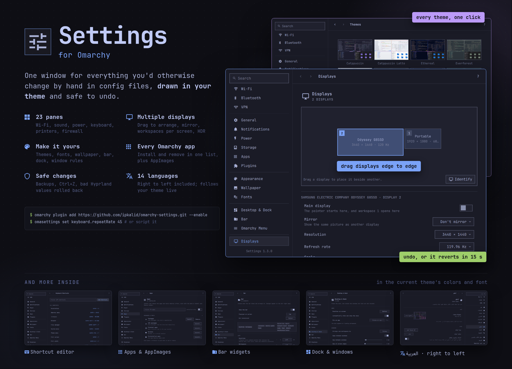

# Settings



One window for the things you would otherwise change by hand in config files
on [Omarchy](https://omarchy.org), laid out like a desktop settings app and
drawn like the Omarchy shell's own panels, in the current theme's colors and
monospace font.

- **23 panes**, from Wi-Fi, sound, and power to the keyboard, printers, and
  the firewall, with a search that lists the matching pages and apps in every
  pane and outlines the setting it found.
- **Multiple displays**: drag displays into place edge to edge, identify
  which is which, pick the main display, mirror one onto another, choose
  which workspaces open where, and set adaptive sync, 10-bit color, and HDR.
  Each monitor keeps its settings on whatever port it is plugged into.
- **Make it yours**: themes, fonts, wallpaper, the bar's widgets, the dock,
  window rules, and the Omarchy menu.
- **Every app Omarchy offers**, installed and removed from one list, plus
  AppImages added to the launcher with their icons and kept up to date.
- **Safe changes**: a backup before every rewrite, Ctrl+Z for everything,
  Hyprland changes rolled back if Hyprland rejects them, and display changes
  undone unless you keep them.
- **14 languages**: Arabic, Chinese (Simplified and Traditional), English,
  French, German, Italian, Japanese, Korean, Polish, Portuguese (Brazil),
  Russian, Spanish (Mexico), and Turkish, right to left included. Omarchy's
  other languages get their number and date formats and English text.
  Theme, text size, corner, and language changes show up live.
- **Scriptable**: every setting can be read and changed with the
  `omasettings` command, for scripts and AI agents.

| Pane | What's in it |
| --- | --- |
| Wi-Fi | Networks, hidden networks, DNS servers, Wi-Fi band |
| Bluetooth, VPN | Pairing; WireGuard and OpenVPN connections (import, sign in, install support) |
| Power | Power mode now, on the adapter, and on battery; hibernation |
| General | About, updates and update channel, language, time zone and clock, default apps and file types, login items, web apps, storage and snapshots, changes and backup |
| Apps | Everything Omarchy's Install and Remove menus offer (browsers, AI apps, coding agents, services, editors, terminals, games, dev environments, dictation, package pickers), with what's installed, so those menus can stay hidden; AppImages, added to the app launcher with their own icons and updated from where their makers publish them |
| Appearance | Theme gallery, installing and removing themes, corners, transparency, animations, text size, font |
| Desktop & Dock, Bar, Omarchy Menu, Plugins | Dock and pinned apps, window layout and gaps, window rules, focus; the bar's widgets and their order; hiding parts of the Omarchy menu, your own menu items, and Settings' pages in the menu search; shell plugins and updates |
| Displays, Wallpaper | Arranging displays by dragging them edge to edge, identifying which is which, the main display, mirroring, which workspaces open on which display; resolution, refresh, scale, rotation, adaptive sync, 10-bit color and HDR, remembered per monitor whichever port it is plugged into; Night Shift and its schedule; wallpapers and adding your own |
| Notifications, Sound | Do Not Disturb, crash reports; output and input devices and volume |
| Lock Screen, Login & Security, Firewall | Idle times; password, fingerprint, security keys; ufw on/off and open ports |
| Keyboard, Mouse, Printers | Repeat, layouts, special keys, backlight, a shortcut editor; pointer and trackpad; printers |

## Getting to a page

- **From the Omarchy menu.** Turn on *Find Settings' pages in the menu
  search* in Settings › Omarchy Menu, then press Super + Space and type
  `vpn`, `monitor`, or `date`: every pane and page is there, in your
  language and in English, and opens right where you asked. The entries are
  a hidden group in `omarchy-menu.jsonc`, so they show only in search, never
  while browsing the menu.
- **From a terminal or a keybinding.** `omasettings open vpn` opens a pane,
  and `omasettings open general/datetime` a page inside one (the pages:
  `general/about`, `update`, `language`, `datetime`, `loginitems`,
  `webapps`, `apps`, `troubleshooting`, `settingsapp`; `appearance/themes`,
  `desktop/rules`, `lock/bootscreen`, `keyboard/shortcuts`).
- **One window.** If Settings is already open, any of these switches that
  window to the page and brings it forward instead of opening another.

## Install

Settings ships as an Omarchy plugin. Add it and enable it:

```sh
omarchy plugin add https://github.com/ipkalid/omarchy-settings.git --enable
```

Enabling it builds the app (a minute or so) and installs it for you alone,
under `~/.local`, so no password is needed. A notification says when it's
ready, and Settings is then in the app launcher (Super + Space). After
`omarchy plugin update ipkalid.settings`, it is rebuilt the same way. If a
build tool is missing, a notification offers to add it in a terminal.

### Requirements

Omarchy with shell plugins (Quattro). Building needs `gcc`, `make`, and Qt 6
(`qt6-base`, `qt6-declarative`, `qt6-wayland`, `qt6-imageformats`); Omarchy
has them already, and the plugin offers to add any that are missing. Panes
use the tools Omarchy ships for them and say so when one is missing:
NetworkManager for Wi-Fi, `bluez-utils` for Bluetooth, `pactl` for sound,
`power-profiles-daemon` for power modes, `brightnessctl` for laptop
brightness, `ufw` for the firewall, and CUPS for printers.

Settings changes your own config files (under `~/.config`) only when you
change a setting, keeps a backup before rewriting one, and lists everything
it changed under General › Changes & Backup. On first start it adds a small
theme hook (`~/.config/omarchy/hooks/theme-set.d/omasettings-icon`) that
redraws its icon in the new theme's colors.

The plugin does nothing else in the shell. If the Arch package from
`bin/install` is installed, the plugin leaves it be.

To remove the app as well as the plugin:

```sh
~/.local/share/omasettings/uninstall
omarchy plugin remove ipkalid.settings
```

## How it changes things

Settings never rewrites a file you wrote.

- Where Omarchy has a command for something (`omarchy theme set`,
  `omarchy hyprland corners`, `omarchy bar position`, `omarchy toggle ...`),
  Settings runs that command, so it behaves exactly as Omarchy's menus do.
- Hyprland options (keyboard, mouse, trackpad, gaps, focus, displays) go into
  one generated file, `~/.config/hypr/omasettings.lua`, loaded after your own
  config. After every change Settings reloads Hyprland and checks
  `hyprctl configerrors`; if Hyprland rejects the change, it is rolled back.
  Delete a line there (or run `omasettings reset <id>`) to hand that option
  back to your own files. The choices behind the file are kept in
  `~/.config/omarchy/omasettings.json`.
- So are your own shortcuts, login items, window rules, and Night Shift's
  schedule (which also writes `~/.config/hypr/hyprsunset.conf`, after
  backing up yours). Every change Settings keeps is listed under General >
  Changes & Backup, with a reset for each.
- Idle and lock times are written into `~/.config/omarchy/shell.json` in
  place, keeping its formatting. A file with a syntax error is left alone.
- Display changes undo themselves after 15 seconds unless you keep them, and
  the last display showing its own picture can't be turned off or mirrored
  away. Moving displays in the arrangement applies at once, with an Undo.
  Displays are saved by their make, model, and serial number
  (`desc:...`), so a monitor keeps its settings on any port or dock.
- Interactive setup (passwords, fingerprint, security keys, updates) opens in
  a terminal, the way Omarchy's menus do it.

Everything is written atomically (beside the target, then renamed), and every
change can be undone with Ctrl+Z.

## Keyboard

| Key | Does |
| --- | --- |
| `?` | Show every shortcut |
| `Ctrl+F` or `/` | Search settings |
| `↑` `↓` | Move between panes in the sidebar |
| `Ctrl+↑` `Ctrl+↓` | Previous or next pane from anywhere |
| `Tab`, `Space` | Move between controls, toggle or press the focused one |
| `Alt+←` `Alt+→`, mouse side buttons | Back and forward |
| `Esc` | Clear the search, or go back |
| `Ctrl+Z`, `Ctrl+Shift+Z` | Undo and redo |
| `Ctrl+R` | Reload what the pane shows |
| `Q` | Quit |

## For scripts and agents

Every setting in the window can be read and changed without a display:

```sh
omasettings list --json                 # every setting: type, range, choices, value
omasettings get keyboard.repeatRate
omasettings set keyboard.repeatRate 45 --json
omasettings reset keyboard.repeatRate   # back to your own config
omasettings data monitors --json        # wifi, bluetooth, sinks, monitors, themes, ...
omasettings act shortcut.add "SUPER + E" Files launch org.gnome.Nautilus.desktop
omasettings export ~/Documents           # settings, shortcuts, login items, rules
omasettings import ~/Documents/omarchy-settings-2026-11-06.json
omasettings open displays               # open the window on a pane
omasettings open general/datetime       # or on a page inside one
omasettings skill install               # a short skill so agents know how
```

Commands exit 0 on success and 1 on failure, with the reason on stderr.

## Build

Everything it needs is part of Omarchy.

```sh
bin/build      # build/omasettings
bin/test       # the Qt Test suite, offscreen
bin/install    # makepkg -fsi, so it shows up in the app launcher (Super + Space)
```

## Translations

Catalogs are `src/i18n/<code>.json`, one per Omarchy language code, mapping
English text to its translation; counted strings map to their plural forms.
`ar.json` holds every string Settings shows, and the test suite fails if any
other catalog misses one, changes a placeholder, or lacks a plural form its
language uses.

```sh
tools/i18n.py extract        # strings in the source that ar.json lacks
tools/i18n.py check          # every catalog complete and well formed
tools/i18n.py todo de        # what de.json still needs, as JSON
OMASETTINGS_LANGUAGE_FILE=/tmp/lang build/omasettings   # /tmp/lang holds a code, e.g. de
```

A new catalog also needs a line in `src/resources.qrc`. Use Omarchy's own
terms for the language, from `$OMARCHY_PATH/default/i18n/<code>/`.

## License

MIT. The theme and translator code follows Omacut and Monologue by David
Heinemeier Hansson.
